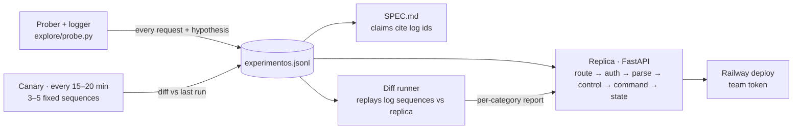

# Design — Black-box replica (Challenge 2)

## Problem
- Undocumented HTTP service: `POST /msg` with `{"m": "CMD;arg…;control"}`, stateful per token, plus `/__reset` and `/health`.
- Deliver an exact replica (same status + body, errors included), a spec where every claim cites the experiment log, and the log itself.
- Graded by 100 hidden sequences (40 single, 45 of 2–5, 15 of 6–12) against the **20:00 version**; the service may change during the day.

## Assumptions
- **Verified in recon:** deterministic after reset (20 examples replayed twice, 0 diffs, log 148–188); unknown route → 404 `E404` before auth (192–194, 204, 208); bad/no token → 401 `E001`, including `/health` (201–203, 205–207); body errors `E100` / `E102` / `E103` (195–198); `X-Req` only on authorized `/msg`, never reset (not compared, ignored).
- **Still assumed:** control digit depends only on the message text; `AC-`/`OP-` counters restart on reset; only the team token is valid in the replica.

## Hard cases
- Control-digit algorithm (`E201` malformed vs `E202` invalid) — blocks every other test.
- Error precedence when one message has several faults (control, arity, unknown command, missing account).
- `E506` limit: per operation or cumulative? `ANULA` side effects; odd amounts (0, negative, decimals, leading zeros).
- Hidden commands beyond the 6 seen; case-insensitive commands (`CONSULTa` works).
- Mid-day behavior change (expected 15:00–16:00).

## Out of scope
- Response headers (not compared) · concurrency / multiple instances (graders hit one process) · persistence across restarts (reset before each test) · replicating rate limits (infrastructure, not service).

## Architecture

## Decisions and trade-offs
| Decision | Rejected alternative | Why |
|---|---|---|
| Deterministic replica, no LLM at runtime | LLM answering in runtime | Exact match tolerates zero variance; $0 per test; < 50 ms |
| Experiment log is also the test set (offline replay) | Live differential calls on every test run | Saves the 8k/day budget; repeatable; same file feeds spec evidence |
| Control digit: sweep 00–99 on ~20 messages, fit formula offline | Guess formulas from 20 examples | Offline guesses (byte sum, mod 97, CRC32, XOR) already failed; sweep costs ~2k requests |
| Scripted exploration, hypotheses drafted with Claude Code | Autonomous LLM explorer (pi) | Faster to build and to control in 7 h; each request keeps an explicit hypothesis |
| Railway, single instance | Render free tier | No sleep before grading; one process keeps state consistent |

## Failure modes
- Undiscovered behavior → explicit default, marked **supuesto** in the spec.
- Service changes → canary diff flags it; re-explore only the affected area; redeploy.
- False claims in the spec cost points → **confirmado** only with ≥ 2 log ids.
- Rate limit (`X-Frontier-Infra`) → excluded from evidence; prober stays < 10 rps.

## Evaluation plan
| Category | Test cases | Metric | Target |
|---|---|---|---|
| Recorded examples | the 20 from `ejemplos.jsonl` | exact match | 100% |
| Single requests | entrada, auth, integridad, each command, each error | exact match per area | ≥ 95% |
| Short sequences (2–5) | create → deposit → transfer → query; ANULA twice | exact match per sequence | ≥ 90% |
| Long sequences (6–12) | limits, balances after ANULA, error precedence | exact match per sequence | ≥ 85% |
| Hold-out | random sequences from a generator, never used for discovery | exact match | ≥ 80% |

- One command (`python evals/run.py`) prints per-category results; report before/after each change and after the mid-day change. Official score from `/evento/resultados` after each deploy.

## Cost and latency
- Runtime: $0 LLM, < 50 ms per step (limit 5 s).
- Request budget (8k/day/token): recon ~210 · control sweep ~2k · exploration ~3k · canary ~1k · reserve ~1.8k. `probe.py` prints used/remaining after each batch.
- LLM spend only for analysis with Claude Code; nothing from the $45 OpenRouter budget planned.
