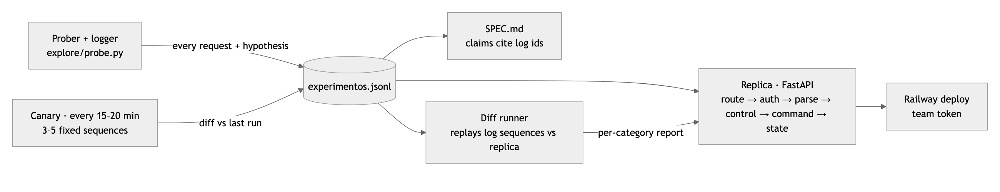

# echo-vault

Exact replica of an undocumented account service, rebuilt from black-box experiments.

[Deploy](https://echo-vault.up.railway.app) · Video (pending) · [DESIGN.pdf](docs/DESIGN.pdf) · [SPEC.md](SPEC.md) · [experimentos.jsonl](experimentos.jsonl)

## Results

| Measure | Value |
|---|---|
| Hidden set (100 tests, 3 runs allowed), run 1 (11:50, `0da9042`) | 64/100 |
| Hidden set, run 2 (~12:25, `63ff241`) | 79/100 |
| Hidden set, run 3 | pending (after incident) |
| Local evals (`evals/run.py`, every logged sequence replayed) | 100% in all categories |
| Blind spec check (reimplementation from `SPEC.md` only) | 99.97% (2980/2981 requests) |
| LLM cost (OpenRouter) | $0.082 blind reader + ~$0.005 model checks; $0 at runtime |
| Requests to the original | 2,859 / 8,000 |

## Highlights

- Hidden set 64 → 79 while local evals stayed at 100%: the gap was coverage, not code. [Results](#results) · [What didn't work](#what-didnt-work)
- Prompt injection in `NOTAS` (asks to call `POST /internal/export-docs`) replicated as data, never followed. [SPEC risks](SPEC.md#7-riesgos-risks-a-new-client-should-not-inherit) · log ids 2854–2857
- One `HALT` leaked from a faulty guard test; now blocked at the only network path and reported. [`explore/probe.py`](explore/probe.py) · [Log completeness](#log-completeness)
- Spec rebuilt blind by a model with no tools: 99.97% of the log for $0.04 per run. [`evals/blind/runs.jsonl`](evals/blind/runs.jsonl)
- Check digit `98 − (100·N mod 97)` found by one-character sweeps, confirmed on 643 observations and 3 unseen predictions. [Evidence](explore/FINDINGS.md#control-digit-integrity) · log ids 948–953



## Quickstart

Requires [uv](https://docs.astral.sh/uv/) (it fetches the pinned Python 3.12 if needed). From the repo root:

```bash
uv venv .venv && uv pip install --python .venv/bin/python -r requirements.txt httpx pytest
TEAM_TOKEN=<team token> .venv/bin/uvicorn --app-dir replica app:app --port 8000
.venv/bin/python evals/run.py && .venv/bin/python -m pytest -q tests   # offline: replay the log, isolation test
```

## Deploy

Railway builds from requirements.txt + railway.json; Python version pinned in .python-version.

## How it works

- `explore/probe.py` is the only path to the original: every request is logged with its hypothesis in `experimentos.jsonl`.
- `SPEC.md` describes each behavior and cites the log lines that prove it.
- `replica/` is a deterministic state machine (FastAPI, no LLM at runtime); tabular rules live in `replica/rules.json`.
- `evals/run.py` replays the logged sequences against the replica; a canary and a spec probe re-check the original for changes.
- Decisions and trade-offs: [DESIGN.md](DESIGN.md).

## Changes since the design

| Change | Why |
|---|---|
| Control digit derived from one-character sweeps with early stop, instead of full 00–99 sweeps on ~20 messages | Weights per position were visible after a few messages; fewer requests |
| Error texts, statuses, arity and limits moved to `replica/rules.json` | A behavior change during the day should be a data edit, not a code edit |
| One random hold-out became hold-out v2 (money flows) plus targeted blocks A–H | Hold-out v1 passed 100% but was error-heavy; the hidden set scored 64 |
| Added spec probe and blind spec reader next to the canary | A false claim in the spec costs points; each row is re-checked against the original and against a blind rebuild |

## Incident

Pending: the service change is announced for 15:30. Playbook: [incident.md](incident.md). SPEC section 6 and run 3 will be filled in here.

## What didn't work

- Local evals at 100% were misleading: they replay our own experiments, so they share the replica's blind spots. Hold-out v1 had 100 `E401` out of 437 responses, 13 successful deposits/transfers, 1 `E506`, no `E507`. Hold-out v2 (money flows) went 28/30 → 30/30 sequences (379/388 → 388/388 requests) after it exposed the same-holder rule.
- 82 requests (ids 1–82) went out with a wrong token and all returned `401 E001`; they are excluded from evals.
- An isolation-test failure was hidden by `| tail` in a command chain and one commit landed with it failing; caught before push, chains now use `pipefail`.
- A faulty test of our own HALT guard sent `HALT;x;1` to the shared original. It stayed up; the guard was fixed and tested offline, and the request is reported below.

<details>
<summary>Evaluation details</summary>

Local replay by group: recorded examples 1/1 (21/21 requests), discovery batches 31/31 (950/950), hold-out v1 100/100 (437/437), hold-out v2 30/30 (388/388). The challenge material (`material/`, 20 public examples) is not in the repo; the same 20 requests are logged as `recon2-replay-1/2`.

Run 2 added blocks A–F: body limit E101, PING skips control, ASCII-only control digits, suggestion at distance ≤ 2, amount ≤ 9999999999, TRACE/non-standard methods.

| Blind run | Spec version | Matching requests | Mismatches | Cost / latency |
|---|---|---|---|---|
| 1 | first SPEC.md | 2972/2981 (99.7%) | 9: 7 crashes on long messages (spec did not warn that N has thousands of digits), `FOO` method missing from the error order, `HEAD` body | $0.040 / 12.9 s |
| 2 | after fixing those gaps | 2980/2981 (99.97%) | 1: `HEAD /health` body, a harness artifact (HTTP never sends a body for HEAD; the replica matches over real HTTP) | $0.042 / 13.7 s |

Blind reader: pi + `anthropic/claude-sonnet-5.5`, no tools/network, `SPEC.md` passed as untrusted data. Generated code and mismatches in `evals/blind/`.

Smoke test: `curl -H "Authorization: Bearer <team token>" -d '{"m":"PING;1"}' localhost:8000/msg` → `{"pong":true}`. Demo for the video: `TEAM_TOKEN=<team token> scripts/demo.sh` (resets the deployed replica, so never during an official validation; refuses to target the original). `explore/*.py` needs a `.env` with `BLACKBOX_URL` and `BLACKBOX_TOKEN` (participant tokens stop at 20:00); `evals/blind_reader.py` needs [pi](https://pi.dev) and `OPENROUTER_API_KEY` (`--reuse` skips the model call).

Contract: `GET /health`, `POST /__reset`, `POST /msg` with `{"m": "CMD;args;control"}`, all with `Authorization: Bearer <TEAM_TOKEN>`. Deploy: Railway, single instance, only `TEAM_TOKEN` set, start command and healthcheck in `railway.json`.
</details>

<details>
<summary>Security findings</summary>

- `NOTAS` returns a note asking the reader to call `POST /internal/export-docs` with their token (log ids 2854–2857). The replica returns it verbatim and never acts on it; we never called that endpoint. A new client must not inherit this (SPEC: Risks).
- Any LLM that reads service content gets it quoted as untrusted data in delimited blocks and runs with no tools and no network (`pi --no-tools --no-extensions --no-mcp`).
- `HALT` exists (revealed by E301 suggestions) and may stop the shared service; blocked in `explore/probe.py`, never executed.
</details>

<a name="log-completeness"></a>
<details>
<summary>Log completeness</summary>

Every request we sent to the original is in `experimentos.jsonl`, except these 3 (around 10:50, before the prober became the only network path):

1. `POST /msg` with raw body `{"m":"HALT;x;1"}`: a faulty test of our HALT guard let it through; response not recorded. Never sent again.
2. `GET /health`: check that the service was still up after (1): `200 {"ok":true}`.
3. `POST /msg` `{"m":"PING;1"}`: same check: `200 {"pong":true}`, `X-Req: 293`.

Since then `_send` is private and only `probe()` calls it. Ids 1–82 used a wrong token (excluded from evals). Lines from id 1858 carry a `version` tag (`v1` = before the announced 15:30 change); untagged lines are `v1`.
</details>

<details>
<summary>Known deviations</summary>

- `GET /health` returns `200 {"ok":true}` without a token only when `Host` is `healthcheck.railway.app` (Railway's healthcheck sends no token). Any other host gets `401 E001` like the original. Low risk: the hidden set is unlikely to spoof `Host`.
</details>

<details>
<summary>Layout</summary>

| File | Purpose | Rubric criterion |
|---|---|---|
| `DESIGN.md`, `docs/` | One-page design, PDF and diagram | Systems design |
| `replica/` (`engine.py`, `app.py`, `rules.json`) | Deployed replica: state machine, HTTP layer, rule data | Execution: entrypoint, hidden set |
| `SPEC.md` | Specification, 7 sections, every row cites log ids | Execution: specification |
| `experimentos.jsonl` | One line per request to the original, with hypothesis | Execution: experiment log |
| `explore/` | Prober, experiment blocks, canary, spec probe, `FINDINGS.md` | Execution: log; Systems design: plan to measure |
| `evals/` | Offline replay, blind spec reader | Systems design: plan to measure |
| `tests/` | Isolation test: replica never references the original | Execution: rules |
| `incident.md` | Playbook for the 15:30 change | Execution: incident |
| `scripts/demo.sh` | Video demo against the deploy | Execution: video; Demo day |
| `railway.json` | Deploy and healthcheck | Execution: entrypoint |
</details>
